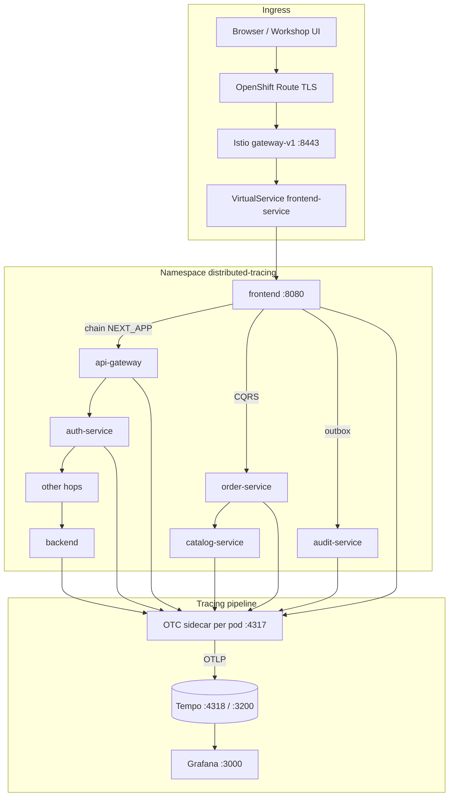
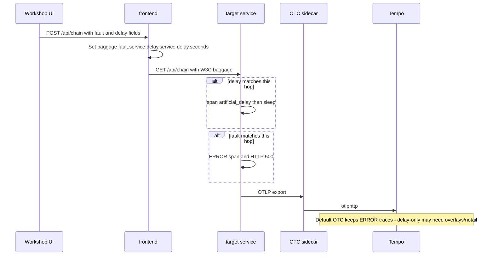

# Distributed Tracing Workshop

OpenShift demo for debugging multi-service latency and failures with **Istio**, **OpenTelemetry**, **Grafana Tempo**, and a single Python app deployed as many named microservices.

Faults and delays are **application-level** (OpenTelemetry baggage + intentional errors / sleeps). They are not Istio VirtualService fault injection.

---

## 1. Prerequisites

- OpenShift (or Kubernetes with Routes / equivalent ingress)
- Istio (revision `default`) with native sidecars
- OpenTelemetry Operator
- cert-manager
- Pull access to `quay.io/rhn_support_milang/distributed-tracing:v1.0.0`

---

## 2. What gets deployed

Everything lands in namespace **`distributed-tracing`**.

| Kind | Name(s) | Role |
|------|---------|------|
| App deployments | `frontend` → … → `backend` (20 services) | Same image; identity via `SERVICE_NAME` / `NEXT_APP` |
| Observability | `tempo`, `grafana` | Trace store + Explore UI |
| Ingress | `gateway-v1` + OpenShift Route | TLS entry to `frontend` |
| Mesh policy | Sidecar, PeerAuthentication, ServiceEntry, DestinationRule | mTLS + local OTC egress |
| OTC CRs | one sidecar collector per app (+ `gateway-v1`) | Receive OTLP, export to Tempo |

### Application chain (default `NEXT_APP` hops)

```
frontend → api-gateway → auth-service → user-service → session-service
  → catalog-service → search-service → recommendation-service → cart-service
  → order-service → inventory-service → payment-service → billing-service
  → shipping-service → notification-service → review-service → analytics-service
  → reporting-service → audit-service → backend
```

| Deployment | Extra role beyond chain hop |
|------------|-----------------------------|
| `frontend` | Workshop UI; orchestrates chain, CQRS, inbox/outbox |
| `order-service` | CQRS write / command side |
| `catalog-service` | CQRS projection + query side |
| `audit-service` | Inbox consumer for outbox demo |
| `backend` | Chain terminus (no `NEXT_APP`) |

Each app pod typically runs **three containers**: app, Istio sidecar, OpenTelemetry Collector sidecar.

---

## 3. Component map



### Fault / delay propagation



---

## 4. How the pieces interact

### Request path

1. Browser hits the OpenShift Route → Istio `gateway-v1` (HTTPS 8443).
2. VirtualService routes to `frontend:8080`.
3. UI or API starts a workflow; each hop propagates **W3C `traceparent`** and **baggage**.
4. Apps export spans to `http://127.0.0.1:4317` (local OTC via ServiceEntry `otel-collector.local`).
5. OTC ships to Tempo; Grafana Explore queries Tempo on `:3200`.

### Workflows

| Workflow | Entry | Path | Delay window |
|----------|-------|------|--------------|
| Fault / delay chain | `POST /api/chain` | Full 20-hop sync chain | ~1–60s |
| CQRS | `POST /api/cqrs/start` | frontend → order-service (command) → catalog-service (project + query) | 120–300s |
| Inbox / Outbox | `POST /api/outbox/start` | frontend outbox → audit-service inbox (then duplicate delivery) | 120–300s |

Injection is controlled per request:

| JSON field | Values | Effect |
|------------|--------|--------|
| `fault_service` | `"none"`, `"random"`, or service name | Matching hop records exception, span ERROR, HTTP 500 |
| `delay_service` | `"none"`, `"random"`, or service name | Matching hop creates `artificial_delay` and sleeps |
| `delay_seconds` | number (clamped to workflow window) | Sleep duration; omit for random |

Baggage keys: `fault.service`, `delay.service`, `delay.seconds`, plus consumed flags so effects apply once per service.

### Tail sampling (important for delays)

Default OTC sidecars use **tail sampling: only-errors**. Fault traces are kept. **Delay-only** successful traces may be dropped.

To keep all traces:

```bash
kubectl apply -k overlays/notail
```

That switches inject annotations to `*-notail` collectors (full export).

---

## 5. Deploy step by step

### Step 1 — Set the gateway hostname

Edit `k8s/gateway/kustomization.yaml` and set your cluster host:

```yaml
configMapGenerator:
- name: gateway-params
  literals:
  - hostname=tracing.apps.<your-cluster-domain>
```

This value is replaced into the Certificate, Route, Gateway, and VirtualService.

### Step 2 — Apply the stack

```bash
# Default: ERROR-only tail sampling
kubectl apply -k k8s

# Optional: retain delay-only and successful traces
kubectl apply -k overlays/notail
```

### Step 3 — Wait for readiness

```bash
kubectl -n distributed-tracing get pods -w
kubectl -n distributed-tracing get route,gateway,virtualservice
```

Expect app pods with Istio + OTC sidecars, plus `tempo`, `grafana`, and `gateway-v1`.

### Step 4 — Open the UI

```bash
# Hostname from Step 1
open "https://tracing.apps.<your-cluster-domain>/"
# or /ui
```

### Step 5 — (Optional) Build / push a custom image

```bash
podman build -t quay.io/rhn_support_milang/distributed-tracing:v1.0.0 .
# Multi-arch Tekton pipeline: see pipeline.yml
```

Root kustomize rewrites `localhost/distributed-tracing` → `quay.io/rhn_support_milang/distributed-tracing:v1.0.0`.

---

## 6. Run the demos step by step

### Chain (fault + delay)

1. Open the UI → **Fault / Delay chain**.
2. Pick a fault service (or leave random / No error).
3. Pick a delay service and optional seconds (1.01–60).
4. Submit and inspect the JSON (`fault_triggered`, `delay_triggered`, nested `downstream`).

CLI:

```bash
export HOST=tracing.apps.<your-cluster-domain>

# Healthy chain
curl -k -X POST "https://${HOST}/api/chain" \
  -H 'Content-Type: application/json' \
  -d '{"fault_service":"none","delay_service":"none"}'

# Pin fault + delay
curl -k -X POST "https://${HOST}/api/chain" \
  -H 'Content-Type: application/json' \
  -d '{"fault_service":"payment-service","delay_service":"inventory-service","delay_seconds":5}'
```

### CQRS

1. UI → **CQRS** (participants: frontend, order-service, catalog-service).
2. Expect 2–5 minutes if a delay is selected.
3. Response includes command write model, projection, and query view.

```bash
curl -k -X POST "https://${HOST}/api/cqrs/start" \
  -H 'Content-Type: application/json' \
  -d '{"item":"widget","quantity":2,"fault_service":"none","delay_service":"order-service","delay_seconds":180}'
```

### Inbox / Outbox

1. UI → **Inbox / Outbox** (frontend → audit-service).
2. First delivery may delay/fault; duplicate delivery is idempotent (no second long sleep).

```bash
curl -k -X POST "https://${HOST}/api/outbox/start" \
  -H 'Content-Type: application/json' \
  -d '{"note":"ship-confirmation","fault_service":"audit-service","delay_service":"none"}'
```

### Discover runtime config

```bash
curl -k "https://${HOST}/api/meta" | jq .
# Or from inside the cluster:
kubectl -n distributed-tracing exec deploy/frontend -c frontend -- \
  curl -s localhost:8080/api/meta | jq .
```

---

## 7. Debug failure and delay injections

Work through these in order.

### Step 1 — Confirm the request chose the right targets

From the UI/API response, note:

- `fault_service` / `fault_triggered`
- `delay_service` / `delay_seconds` / `delay_triggered`
- nested `downstream` (chain) or `command` / `delivery` (CQRS / outbox)

If both are `"none"` or `*_triggered: false`, nothing was injected on that hop.

### Step 2 — Check the target pod logs

```bash
# Example: fault on payment-service
kubectl -n distributed-tracing logs -l app=payment-service -c payment-service --tail=100

# Example: delay on inventory-service (request blocks for delay_seconds)
kubectl -n distributed-tracing logs -l app=inventory-service -c inventory-service --tail=100
```

Look for `Random fault triggered in <service>` and long-running requests matching the delay.

### Step 3 — Verify sidecars and inject annotations

```bash
kubectl -n distributed-tracing get pods
kubectl -n distributed-tracing get deploy frontend -o yaml | grep -E 'opentelemetry|istio'

# OTC / Istio logs if export looks broken
kubectl -n distributed-tracing logs -l app=frontend --all-containers --tail=50
```

Pods should show Istio + OTC. Inject annotation is `sidecar.opentelemetry.io/inject: <name>` or `<name>-notail`.

### Step 4 — Find the trace in Grafana / Tempo

```bash
kubectl -n distributed-tracing port-forward svc/grafana 3000:3000
# http://localhost:3000  →  admin / admin  →  Explore  →  Tempo
```

What to search for:

| Signal | Where |
|--------|--------|
| Span status **Error** | Fault hop |
| Span name `artificial_delay` | Delay hop |
| Attributes `fault.triggered`, `delay.triggered`, `fault.service`, `delay.seconds`, `workflow.name` | Filter / confirm |
| Span `process_business_logic` | Business effects |

Tips:

- Combine a **fault** with a delay if you stay on default tail sampling (errors retained).
- Use `overlays/notail` when debugging **delay-only** runs.
- Tempo retention in this demo is short (~3h); re-run the workflow if the trace aged out.

Direct Tempo API (optional):

```bash
kubectl -n distributed-tracing port-forward svc/tempo 3200:3200
# http://localhost:3200
```

### Step 5 — Mesh / ingress sanity checks

```bash
kubectl -n distributed-tracing get gateway,virtualservice,destinationrule,serviceentry
kubectl -n distributed-tracing describe route frontend-route-v1
kubectl -n distributed-tracing logs -l istio=gateway-v1 --tail=100
```

If the UI never loads, fix hostname / cert / Route before chasing injection.

### Step 6 — Common failure modes

| Symptom | Likely cause |
|---------|----------------|
| No traces for delay-only | Default ERROR-only tail sampling → apply `overlays/notail` or add a fault |
| HTTP 500 but workflow JSON continues | Expected for demo faults (`fault_triggered`); check Tempo ERROR span |
| Request times out at ~6 minutes | Pattern delay up to 300s; client/gunicorn timeout is 360s — keep delays ≤300 |
| Delay applied twice on same service | Should not happen; consumed baggage / `_mark_downstream_effects_consumed` prevents re-apply |
| Empty Tempo | OTC not injected, wrong Tempo address, or sampling dropped the trace |

---

## 8. Repository layout

| Path | Purpose |
|------|---------|
| `app.py` | Workflows, OTel, fault/delay logic |
| `static/index.html` | Workshop UI |
| `Dockerfile` / `gunicorn_worker.py` | Runtime image (timeout 360s) |
| `k8s/` | Namespace, mesh policy, deployments, services, OTC, gateway |
| `k8s/deploy/` | App + Tempo + Grafana deployments |
| `k8s/otc/` | Tail-sampling OTC CRs |
| `k8s/otc/no-tail-sampling/` | Full-export OTC CRs |
| `overlays/notail/` | Switch pods to notail collectors |
| `pipeline.yml` | Tekton multi-arch image build |

---

## 9. Quick reference

| Item | Value |
|------|--------|
| Namespace | `distributed-tracing` |
| App port | `8080` |
| Grafana | `:3000` (`admin` / `admin`) |
| Tempo UI/API | `:3200` · OTLP `:4317` / `:4318` |
| Chain delay | ~1.01–60s (`CHAIN_DELAY_*` env) |
| CQRS / Outbox delay | 120–300s |
| HTTP timeout | 360s (`HTTP_TIMEOUT_SECONDS`) |
| Default apply | `kubectl apply -k k8s` |
| Keep all traces | `kubectl apply -k overlays/notail` |
